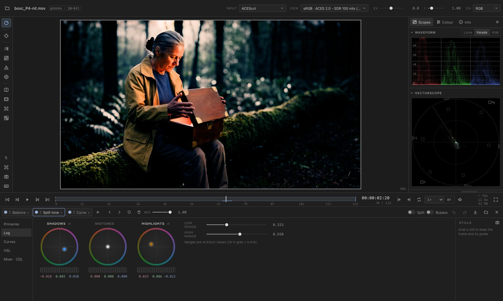
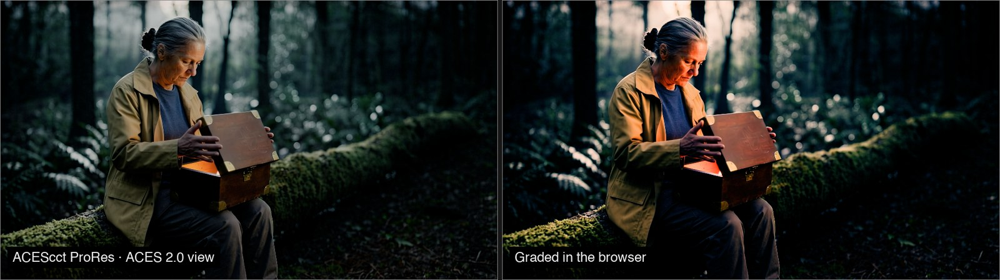
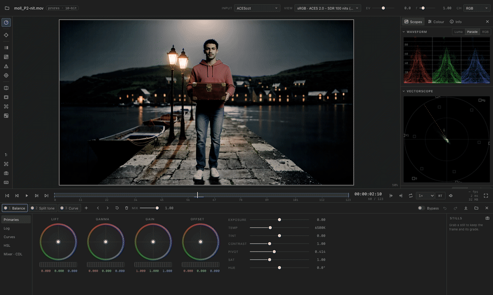
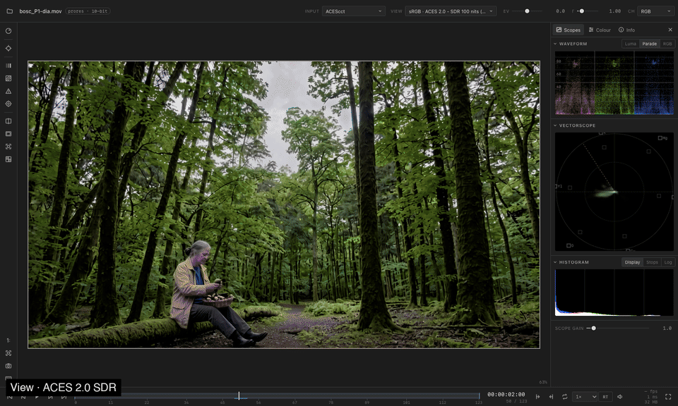
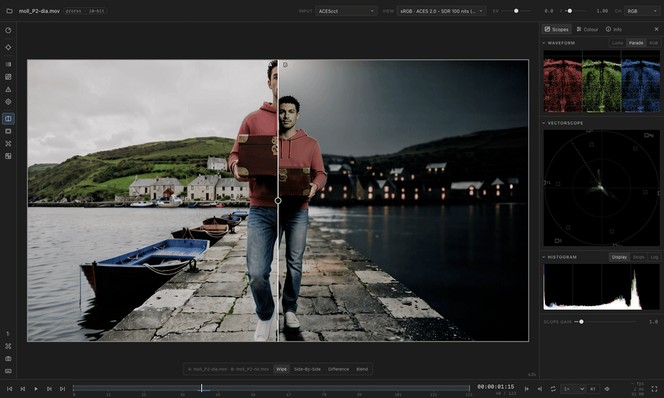

<div align="center">

# scenegrade

**Colour grading and review in the browser.**<br>
ACES 2.0 · OpenEXR · ProRes · WebGPU · one HTML tag.

[](https://github.com/hitaboy/scenegrade/actions/workflows/ci.yml)
[](https://www.npmjs.com/package/@scenegrade/element)
[](LICENSE)
[](https://hitaboy.github.io/scenegrade/)

[**Live demo**](https://hitaboy.github.io/scenegrade/) · [Integration](docs/integration.md) ·
[Grading engine](docs/grading.md) · [Architecture](docs/architecture.md)

<a href="https://hitaboy.github.io/scenegrade/"></a>

</div>

scenegrade opens camera and VFX media (EXR sequences, ProRes 4444, log footage) in any web page
with real ACES colour management and lets you **grade it there**: nodes, colour wheels, curves and
HSL curves, checked on GPU scopes. No install, no server-side processing, no special headers.



## Grade anywhere



- **Node grade on the GPU.** Each node has these controls:
  - exposure, white balance (temperature/tint) and a channel mixer;
  - lift / gamma / gain / offset wheels with masters, contrast with pivot, saturation and hue;
  - log wheels for shadows, midtones and highlights, plus an ASC CDL;
  - Y / R / G / B curves and five HSL curves;
  - mix, and enable or bypass.
- **Colour-managed.** The grade runs in ACEScct (with a linear stage in ACEScg), before the ACES 2.0
  output transform, the same way grading works in Resolve or Baselight.
- **Fast.** One WGSL interpreter evaluates every node, so editing never recompiles a shader. Three
  full nodes cost about 2.4 ms per frame on 3 Mpx, so 4K ProRes keeps playing at 24 fps.
- **Accurate.** A CPU reference mirrors the shader; across 200 random grades the GPU stays within
  2e-4 ACEScct of it.
- **Practical.**
  - Each drag is one undo step; stills keep a frame together with its grade.
  - Grades save and load as `.grade.json`.
  - `getGrade()`, `setGrade()` and the `gradechange` event let your app store grades in its own
    backend.

## See what you are doing



| Scopes                                                                                             | Overlays                                                                                                                                         | Probe                                                                                               |
| -------------------------------------------------------------------------------------------------- | ------------------------------------------------------------------------------------------------------------------------------------------------ | --------------------------------------------------------------------------------------------------- |
| Waveform (luma, RGB, parade), vectorscope with targets and skin line, histogram (display or stops) | False colour (scene stops, ARRI-style or EL Zone, or display IRE), zebra, clipping and crushed blacks, NaN/Inf, focus peaking, safe areas, masks | File value, ACEScg, graded value, display code values, stops, nits; area average and pinned samples |

All scopes run as WebGPU compute shaders over the exact display chain, so they match what you see,
grade included.

## Compare



The **Split** toggle compares the same frame graded and ungraded, with a wipe or side by side, like
a grading suite's split screen. A second clip can be compared A/B with a wipe, side by side,
difference or blend; load it, or drop it while holding Alt.

## Embed it

**Any web page:**

```html
<script
  type="module"
  src="https://cdn.jsdelivr.net/npm/@scenegrade/element/dist/scenegrade-player.js"
></script>

<scenegrade-player
  src="shot_010.mov"
  input-space="arri-logc4"
  view="srgb-aces2-sdr709"
  layout="grade"
></scenegrade-player>
```

**Save grades to your backend:**

```js
const player = document.querySelector('scenegrade-player');
player.setGrade(await (await fetch('/api/shots/010/grade')).json());
player.addEventListener('gradechange', (e) =>
  fetch('/api/shots/010/grade', { method: 'PUT', body: JSON.stringify(e.detail.grade) }),
);
```

**Svelte 5:**

```svelte
<script>
  import { ScenePlayer } from '@scenegrade/svelte';
</script>

<ScenePlayer src={{ url: '/plates/a.####.exr', first: 1001, last: 1100 }} layout="grade" />
```

**Headless (React, Vue, plain JS):**

```js
import { Player } from '@scenegrade/core';

const player = new Player();
await player.attach(canvas);
await player.load('/renders/v002.mov');
player.update({ inputSpace: 'acescct', view: 'pq-aces2-hdr1000-p3' });
player.updateGradeNode(null, { primaries: { contrast: 1.15 }, linear: { temperature: 5600 } });
```

Attributes, methods, events, theming and CSP notes are in the [integration guide](docs/integration.md).

## What it reads

|            |                                                                                                                                                                                                                                                                                                                                                          |
| ---------- | -------------------------------------------------------------------------------------------------------------------------------------------------------------------------------------------------------------------------------------------------------------------------------------------------------------------------------------------------------- |
| **EXR**    | Scanline, tiled, multipart and multi-layer (AOVs); every compression (ZIP/ZIPS, PIZ, PXR24, B44/B44A, DWAA/DWAB, HTJ2K); sequences (`####`, `%04d`, folders, drag & drop)                                                                                                                                                                                |
| **ProRes** | 422 Proxy/LT/422/HQ and 4444/4444 XQ with alpha, 10/12-bit, decoded in WebAssembly. 4K 422 HQ plays at 24 fps on an M3 Pro                                                                                                                                                                                                                               |
| **Video**  | H.264, HEVC, AV1 and VP9 via WebCodecs (10-bit kept for AV1/VP9) · PNG, JPEG, WebP, AVIF                                                                                                                                                                                                                                                                 |
| **Colour** | ACES 2.0 output transforms baked from the official OpenColorIO config: sRGB, Rec.1886, Display P3, Rec.2100 PQ/HLG 1000 nits, P3 HDR, plus ACES 1.x SDR for comparison · 27 input spaces matched to OCIO (ACEScg/cct, ARRI LogC3/4, S-Log3, RED Log3G10, Canon Log, V-Log, Apple Log, DaVinci Intermediate…) · HDR output on HDR displays · `.cube` LUTs |

## How it works

```
 file ─► demux (Mediabunny) ─► decode ──────────► upload ─► decode pass ─► scene texture ─► display pass ──────────► canvas
         EXR ─► OpenEXR WASM (worker pool)        (GPU)     YUV→RGB,        (rgba16float,   viewer exposure · GRADE   (rgba16float,
         ProRes ─► TurboRes WASM                             input → ACEScg   ACEScg)         · CDL · LUT · ACES view   HDR "extended")
         H.264/HEVC/AV1 ─► WebCodecs                                               │           · overlays
                                                                                    └─► scopes compute pass (same WGSL chain)
```

- **WebGPU does all the pixel work:** colour conversion, grade, view transform, overlays and scopes.
- **WebAssembly only decodes:** OpenEXR 3.4 (the official OpenEXRCore library) and ProRes
  (TurboRes) run in Web Workers, without `SharedArrayBuffer`.
- **OpenColorIO runs at build time.** The ACES views are baked into 49³ LUTs. Against exact OCIO,
  the sRGB view measures ΔE2000 mean 0.16 and p99 0.8.

More: [architecture](docs/architecture.md) · [benchmarks](docs/benchmarks.md) ·
[grading engine](docs/grading.md) · [UI design](docs/design.md).

## Packages

| Package                                     | What                                                                                   |
| ------------------------------------------- | -------------------------------------------------------------------------------------- |
| [`@scenegrade/element`](packages/element)   | `<scenegrade-player>` Web Component (one script tag)                                   |
| [`@scenegrade/svelte`](packages/svelte)     | Svelte 5 components: `ScenePlayer`, `GradePanel`, `ColorWheel`, `CurveEditor`, scopes… |
| [`@scenegrade/core`](packages/core)         | Headless engine: `Player`, grade engine, WebGPU renderer, scopes, colour, media        |
| [`@scenegrade/exr-wasm`](packages/exr-wasm) | OpenEXR → WebAssembly decoder and worker pool                                          |

## Browser support

scenegrade needs WebGPU: Chrome or Edge 113+, Safari 26+, or Firefox 141+ on Windows.

- **HDR output** needs an HDR display and `toneMapping: "extended"`, which Chrome supports.
- **ProRes** decodes at full bit depth in every WebGPU browser.
- **HEVC** depends on the platform decoder and may arrive as 8-bit.

## Develop

```sh
pnpm install
packages/exr-wasm/scripts/build-wasm.sh   # OpenEXR -> WASM (Docker)
pnpm media                                # synthetic test EXRs and clips (uv + ffmpeg)
pnpm dev                                  # demo on http://localhost:5199
pnpm test && pnpm e2e                     # unit tests, Playwright in Chrome with WebGPU
```

See [CONTRIBUTING.md](CONTRIBUTING.md). The README media were captured with
`apps/demo/scripts/readme-media.mjs`. The footage consists of AI-generated shots by the author,
delivered as ACEScct ProRes 422 HQ masters.

## License

[Apache-2.0](LICENSE). Third-party components (OpenEXR, OpenJPH, libdeflate, Imath, Mediabunny,
TurboRes, ACES transforms, OpenColorIO) and their licences are listed in
[THIRD_PARTY_NOTICES.md](THIRD_PARTY_NOTICES.md). ACES is a trademark of the Academy of Motion
Picture Arts and Sciences; this project is not affiliated with or endorsed by the Academy.
