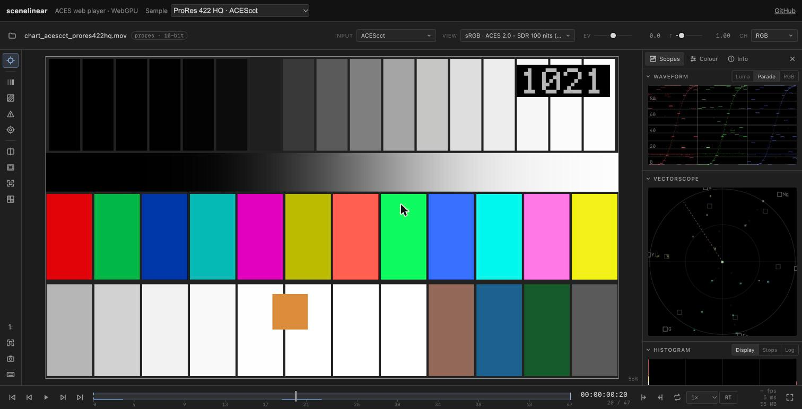

# scenelinear

**Open-source WebGPU player for EXR, ProRes and video with ACES colour management** — histogram,
waveform, vectorscope, false colour, zebra, pixel probe and A/B compare, embeddable in any web page
with one tag.



```html
<script
  type="module"
  src="https://cdn.jsdelivr.net/npm/@scenelinear/element/dist/scenelinear-player.js"
></script>

<scenelinear-player
  src="shot_010.mov"
  input-space="arri-logc4"
  view="srgb-aces2-sdr709"
></scenelinear-player>
```

> **Name:** "scenelinear" is a working name. ACES is a trademark of the Academy of Motion Picture
> Arts and Sciences; this project is not affiliated with or endorsed by the Academy.

## Features

|                 |                                                                                                                                                                                                                                                                                                                                                                                                                                                                                                                                                                                                |
| --------------- | ---------------------------------------------------------------------------------------------------------------------------------------------------------------------------------------------------------------------------------------------------------------------------------------------------------------------------------------------------------------------------------------------------------------------------------------------------------------------------------------------------------------------------------------------------------------------------------------------- |
| **Formats**     | OpenEXR (scanline, tiled, multipart, multi-layer/AOVs; NONE, RLE, ZIPS, ZIP, PIZ, PXR24, B44, B44A, DWAA, DWAB, HTJ2K) · EXR sequences (`####`, `%04d`, folders, drag & drop) · **Apple ProRes** 422 Proxy/LT/422/HQ and 4444/4444 XQ with alpha, 10/12-bit · H.264 / HEVC / AV1 / VP9 via WebCodecs · PNG / JPEG / WebP / AVIF                                                                                                                                                                                                                                                                |
| **Colour**      | ACES 2.0 (2.1 config) output transforms baked from the official OpenColorIO studio config: sRGB, Rec.1886, Display P3, Rec.2100 PQ/HLG 1000 nits (P3 / Rec.2020), Display P3 HDR, plus ACES 1.x SDR Video for comparison · 27 input spaces verified against OCIO (ACEScg, ACES2065-1, ACEScct/cc, linear and display Rec.709/P3/2020, ARRI LogC3/LogC4, Sony S-Log3, RED Log3G10, Canon Log 2/3, Panasonic V-Log, Apple Log, DaVinci Intermediate, BMD Film Gen5, DJI D-Log…) · HDR output on HDR displays · exposure, saturation, gamma · ASC CDL (in ACEScct) · `.cube` look or display LUTs |
| **Analysis**    | Histogram (display or scene stops, linear/log) · waveform (luma, RGB overlay, RGB parade) · vectorscope with 75/100 % targets and skin line · false colour (scene stops ARRI-style / EL Zone, or display IRE) · zebra (high + mid band) · clipping, crushed blacks and NaN/Inf detection · focus peaking · pixel probe (file value, ACEScg, display code values, stops, nits, area average, pinned samples) · safe areas, centre, thirds and aspect masks                                                                                                                                      |
| **Review**      | Frame-accurate playback, J/K/L, in/out, loop / ping-pong / once, real-time or every-frame, audio sync · A/B compare: wipe, side by side, difference, blend · data/display window (overscan) · channel and layer isolation · snapshot · timecode (incl. drop-frame)                                                                                                                                                                                                                                                                                                                             |
| **Integration** | `<scenelinear-player>` Web Component · Svelte 5 components · headless TypeScript core for any UI · no server headers needed (works without COOP/COEP)                                                                                                                                                                                                                                                                                                                                                                                                                                          |

## How it works

```
 file ─► demux (Mediabunny) ─► decode ────────────────► upload ─► decode pass ─► scene texture ─► display pass ─► canvas
         EXR ─► OpenEXR WASM (worker pool)              (GPU)     YUV→RGB,        (rgba16float,   exposure, CDL,     (rgba16float,
         ProRes ─► TurboRes WASM                                   input → ACEScg   ACEScg)         ACES view LUT,     HDR "extended")
         H.264/HEVC/AV1 ─► WebCodecs                                                     │           overlays
                                                                                          └─► scopes compute pass (same WGSL chain)
```

- **WebGPU** does all pixel work: colour conversion, view transform, overlays and the scopes
  (compute shaders with atomics). The scopes run on a 512-px-wide sample grid, so their cost does
  not grow with the image size.
- **WASM** only decodes: OpenEXR 3.4 (official OpenEXRCore) and ProRes (TurboRes) run in Web
  Workers, with no `SharedArrayBuffer`. Pages need no special headers.
- **OpenColorIO runs at build time, not in the browser.** `tools/ocio-bake` evaluates the official
  ACES configs and writes 49³ LUTs, 0.94 MB each, plus test fixtures. Measured accuracy against OCIO
  (sRGB view) is ΔE2000 mean 0.16 / p99 0.8. Input transforms are analytic and match OCIO to 4e-5.

Details: [docs/architecture.md](docs/architecture.md) · [benchmarks](docs/benchmarks.md) ·
[UI design](docs/design.md) · [integration guide](docs/integration.md).

## Packages

| Package                                      | What                                                                             |
| -------------------------------------------- | -------------------------------------------------------------------------------- |
| [`@scenelinear/element`](packages/element)   | `<scenelinear-player>` Web Component (one script tag)                            |
| [`@scenelinear/svelte`](packages/svelte)     | Svelte 5 components: `ScenePlayer`, `Viewer`, `Scope`, `Transport`, panels       |
| [`@scenelinear/core`](packages/core)         | Headless engine: `Player`, WebGPU renderer, scopes, colour module, media sources |
| [`@scenelinear/exr-wasm`](packages/exr-wasm) | OpenEXR → WebAssembly decoder + worker pool                                      |

## Browser support

WebGPU is required: Chrome / Edge 113+, Safari 26+, Firefox 141+ on Windows (other Firefox platforms
are rolling out). HDR output needs an HDR display, and a browser that supports
`toneMapping: "extended"` on WebGPU canvases (Chrome). ProRes works in every WebGPU browser; HEVC
depends on hardware support. ProRes keeps its full 10/12-bit depth everywhere, and AV1 / VP9 use
the browser's software decoder to keep 10-bit planes. Hardware-decoded HEVC may come back as 8-bit
RGBA on some platforms.

## Develop

```sh
pnpm install
packages/exr-wasm/scripts/build-wasm.sh   # OpenEXR -> WASM (Docker, emscripten/emsdk)
pnpm media                                # test EXRs + ProRes/HEVC/H.264 clips (uv + ffmpeg)
pnpm dev                                  # demo on http://localhost:5199
pnpm test                                 # unit tests (colour vs OCIO fixtures, EXR decoder, player)
pnpm e2e                                  # Playwright in real Chrome with WebGPU
pnpm build                                # all packages + demo
pnpm bake:luts                            # re-bake ACES LUTs with OpenColorIO (uv)
```

See [CONTRIBUTING.md](CONTRIBUTING.md).

## License

[Apache-2.0](LICENSE). Third-party components (OpenEXR, OpenJPH, libdeflate, Imath, Mediabunny,
TurboRes, ACES transforms, OpenColorIO) and their licences are listed in
[THIRD_PARTY_NOTICES.md](THIRD_PARTY_NOTICES.md).
