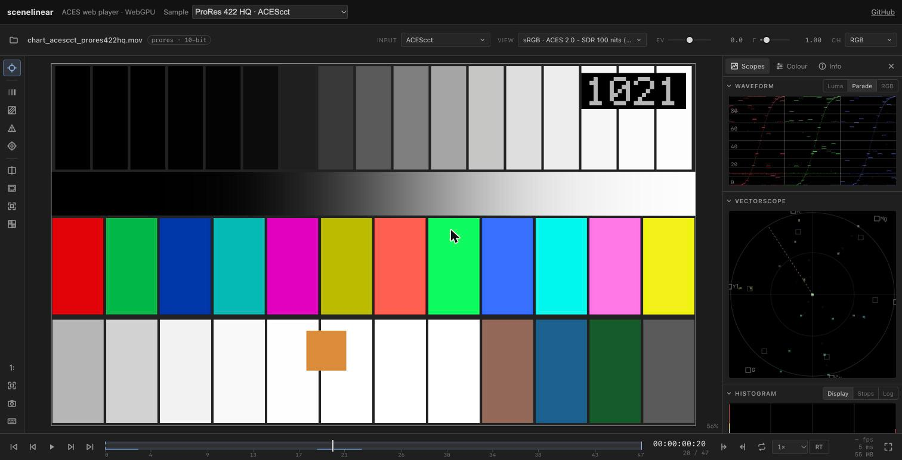

# UI design



## Principles

1. **Neutral grey only.** Every surface has R = G = B. A tinted UI shifts how colour in the image is
   perceived (simultaneous contrast). The single accent, a desaturated blue, marks state only: the
   active tool, toggles and in/out points.
2. **The image comes first.** Panels collapse, `Tab` hides all chrome ("clean" view), and the
   viewer background is a dark neutral (`--sl-viewer-bg`).
3. **Keyboard first,** with RV- and Resolve-like shortcuts (`?` shows them all). Every control is
   also reachable with the mouse and has a visible focus ring.
4. **Numbers you can trust.** Mono font for values; pixel probe values come from the GPU scene
   texture and the CPU reference of the same LUT.
5. **Two densities:**
   - `layout="full"`: review tool with a top bar, tool rail, side panel and transport.
   - `layout="compact"`: embedded, with only the transport plus a settings popover.

## Layout (full)

```
┌──────────────────────────────────────────────────────────────────────────────────────┐
│ [open] name.exr (codec · bits)      INPUT [ACEScg ▾]  VIEW [sRGB · ACES 2.0 ▾] [HDR] │ top bar
│                                     EV ──●── 0.0   γ ──●── 1.00   CH [RGB ▾] LAYER ▾ │
├────┬────────────────────────────────────────────────────────────┬────────────────────┤
│ ⌖  │                                                            │ Scopes│Colour│Info │
│ ▥  │                                                            │ ▾ WAVEFORM  L|P|RGB│
│ ▨  │                         VIEWER                             │ ▾ VECTORSCOPE      │
│ ⚠  │     zoom/pan · guides · masks · wipe handle · pins         │ ▾ HISTOGRAM D|S|Log│
│ ◎  │                                                            │   scope gain       │
│ ◫  │                                              56%           │                    │
├────┴────────────────────────────────────────────────────────────┴────────────────────┤
│ ⏮ ◀| ▶ |▶ ⏭  ━━━━━━━━━━━━●━━━━━━━━━  00:00:01:12   ⇤ ⇥ ⟲ 1× RT 🔊   fps·ms·MB   ⛶     │ transport
│                ▔▔▔▔▔▔▔ cache bar ▔▔▔▔                1036 / 1048                        │
└──────────────────────────────────────────────────────────────────────────────────────┘
Tool rail: probe · false colour · zebra · clipping/NaN · peaking │ compare · guides · aspect
mask · alpha background │ 1:1 · fit · snapshot · shortcuts
```

States covered:

- empty (drop zone and "Open files…");
- loading;
- error toast;
- no WebGPU (explanation plus supported browsers);
- drag over (Alt to compare);
- A/B compare bar (wipe / side by side / difference / blend);
- help overlay;
- HDR badge, shown in warning style when the display isn't HDR.

Responsive behaviour: below 760 px the side panel becomes an overlay drawer and the transport
hides its stats.

## Design tokens

| Token                             | Value                             | Use                      |
| --------------------------------- | --------------------------------- | ------------------------ |
| `--sl-bg`                         | `#161616`                         | app background           |
| `--sl-viewer-bg`                  | `#1c1c1c`                         | viewer, around the image |
| `--sl-surface-1/2/3`              | `#1f1f1f` / `#262626` / `#303030` | bars, controls, hover    |
| `--sl-border` / `-strong`         | `#3a3a3a` / `#4a4a4a`             | separators, inputs       |
| `--sl-text` / `-muted` / `-faint` | `#d6d6d6` / `#9a9a9a` / `#6e6e6e` | text hierarchy           |
| `--sl-accent`                     | `#8fb3e8`                         | active state only        |
| `--sl-warn` / `--sl-danger`       | `#e0b45a` / `#e06a5a`             | dropped frames, errors   |
| `--sl-font`, `--sl-font-mono`     | system UI / UI mono               |                          |
| `--sl-text-xs…lg`                 | 10–13 px                          | dense, tool-like         |
| `--sl-radius`                     | 4 px                              |                          |

## Analysis overlays

| Overlay             | Domain                                                                     | Look                                                  |
| ------------------- | -------------------------------------------------------------------------- | ----------------------------------------------------- |
| False colour, stops | scene-linear luminance (AP1 Y) relative to 18 % grey, after exposure       | ARRI-style or EL Zone bands; legend in the Colour tab |
| False colour, IRE   | display signal (Rec.709 luma, %)                                           | broadcast-style bands                                 |
| Zebra high          | max(R,G,B) of the display signal ≥ threshold (default 95 %)                | animated black/white diagonal stripes                 |
| Zebra mid           | display luma within level ± band (default 70 ± 5 %)                        | light stripes in the opposite direction               |
| Clipping            | any display channel ≥ 99.9 % (shows which channels); all channels ≤ 0.05 % | channel colours / blue                                |
| NaN / Inf           | scene value bit pattern                                                    | blinking magenta/green                                |
| Peaking             | display luma gradient > threshold                                          | red                                                   |

Scopes use black backgrounds and low-contrast graticules: 10 % steps on the waveform, 75/100 %
colour targets and the skin-tone line on the vectorscope, and stops or quartiles on the
histogram.

## Grade palette (`layout="grade"` or `E`)

```
├──────────────────────────────────────────────────────────────────────────────────────┤ transport
│ ● 1 Node 1 •  ● 2 Node 2  [+]   ◀ ▶ ↺ 🗑  MIX ──●── 1.00        ○ Bypass ↶ ↷ ⤓ 📂 ✕ │ node strip
├────────────┬─────────────────────────────────────────────────────────────┬───────────┤
│ Primaries  │   LIFT      GAMMA      GAIN      OFFSET     EXPOSURE ──●──   │ STILLS  📷│
│ Log        │   (◎)       (◎)        (◎)       (◎)        TEMP     ──●──   │ ┌───────┐ │
│ Curves     │   ▥▥▥▥      ▥▥▥▥       ▥▥▥▥      ▥▥▥▥       TINT · CONTRAST  │ │ still │ │
│ HSL        │   r g b     r g b      r g b     r g b      PIVOT · SAT · HUE│ └───────┘ │
│ Mixer · CDL│                                                             │           │
└────────────┴─────────────────────────────────────────────────────────────┴───────────┘
```

- **Wheels:** the puck plane is oriented like the vectorscope (x = B − Y, y = R − Y, with AP1 luma),
  so moving the puck changes colour without changing luma.
  - Dragging is relative; Shift gives fine control.
  - The thumbwheel under each wheel sets the master.
  - Double-click resets; arrow keys nudge.
- **Curves:** the editor works in the ACEScct domain.
  - The HSL curves are deltas around a neutral line, with a hue or luma strip for orientation.
  - The first click on an empty HSL curve adds two neutral anchors, so the edit stays local.
- **Undo:** each gesture is one undo step (the edit is committed on pointer up).
- **Stills:** a still stores a thumbnail and its grade; clicking it applies the grade.
- **Grade files:** the grade saves and loads as `.grade.json`.
